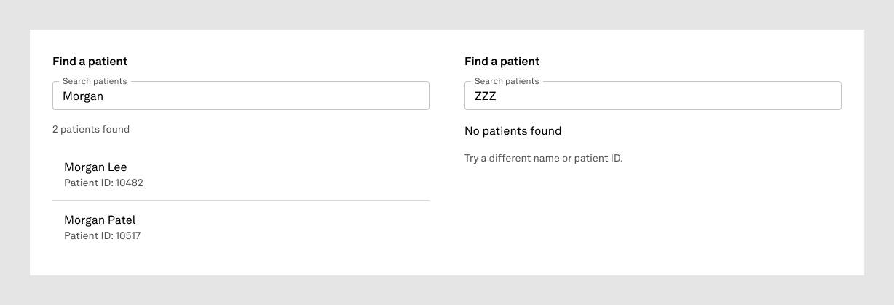

# Your first screen

Build a small patient-search panel with an AI design agent and review the result in Figma. This exercise is for designers. It uses fictional patient details and produces two static visual states: results and no results.

You will learn how to request a composition, recognize library-backed output, and review what the agent built. There is no working search, patient lookup, or navigation in this exercise.

Status: ready for a designer pilot, November 2, 2026. The reference below was verified on October 31. This guide has not yet been tested by a new designer, and completion time is not yet established.

## 1. Get ready

You need an agent client with access to this repository and a Figma connection that can inspect library components, create editable nodes, and capture images. A chat window alone is not sufficient. Connection and permission screens vary by client; this guide does not assume Codex and Claude have identical setup.

Open the repository as the agent's project. Have these resources available:

| Resource | What you need |
|---|---|
| [Design System Rebuild](https://www.figma.com/design/YX2n4YLrEpBXNbcc73T6dw) | Access to the published Tebra components and tokens; this is the source library. |
| [Proposals](https://www.figma.com/design/zKT34LQogNjz3Z07fY4VQB) | Edit access for this exercise. Each attempt gets a new, uniquely named section. |
| Fonts | The library's fonts must load. The reference uses Akkurat LL. |

Ask the agent to check its repository access, Figma connection, source library access, and destination access before building. If it cannot find this guide or cannot access one of those resources, resolve that setup issue first. The build itself must verify actual imported properties and required fonts; access alone does not prove component availability.

For the pilot, Daniel remains the reviewer required by the current builder rules. You can inspect the result yourself, but the agent pauses for Daniel's read before another build batch. Independent review ownership for a wider rollout has not been established.

## 2. See what you are aiming for



[Open the reference in Figma](https://www.figma.com/design/zKT34LQogNjz3Z07fY4VQB?node-id=285-434).

This is the saved October 31 reference, not a screenshot of your new attempt. It demonstrates the intended composition; it does not establish current library publication or consumer-update status. Keep the reference intact.

Both panels are 550 px wide, with a paper background and 16 px padding. Each has the heading “Find a patient” and a small outlined field labeled “Search patients,” without a search icon.

| Results state | Empty state |
|---|---|
| Field value: Morgan | Field value: ZZZ |
| 2 patients found | No patients found |
| Morgan Lee — Patient ID: 10482 | Try a different name or patient ID. |
| Morgan Patel — Patient ID: 10517 | No result rows |
| A divider between the two rows | |

The reference heights are 309 px for Results and 188 px for Empty. Content determines height; these are dated observations rather than fixed-height requirements. Success means correct content, supported library parts, readable layout, and an editable result. An unexplained difference should be reported, not hidden to imitate the screenshot.

## 3. Request your first build

Copy this request into the agent chat opened on the repository:

```text
Use AGENTS.md and FIRST-RUN.md in this repository to build my first
Tebra patient-search composition in the Proposals file:
https://www.figma.com/design/zKT34LQogNjz3Z07fY4VQB

Create a new section named “First run · Patient search” with a unique
attempt suffix. Preserve all existing work and the reference example.

Build the Results and Empty states specified in FIRST-RUN.md, side by
side, each 550 px wide. Use the published Tebra library instances,
supported properties, typography, and bound tokens. These are static
visual states; typing and selecting a patient have no implemented action.

Check the components and tokens available in this consuming file.
Report any missing capability or conflicting evidence. Keep the source
library unchanged and preserve published component internals.

After this batch, capture the assembled section and any necessary
detail crops. Open and visually inspect those images, then display the
actual screenshots in this chat. Include a link to my new Figma section,
a short verification summary, and any limitations. If image display
fails, say so and provide an accessible image link; do not claim I saw it.

Record the batch using the repository workflow and stop for Daniel's
read before starting another build batch.
```

The request names the desired result and delivery expectations. The agent handles component discovery, assembly, verification, and evidence. You should not need to supply internal component IDs or run builder scripts yourself.

## 4. Review what comes back

You should receive the new screenshot in chat, a link to your editable Figma section, and a concise explanation of checks and limitations. The screenshot must show your attempt, not just repeat the reference above.

Check these together with the agent's verification summary:

- Both states are present, with the specified text and 550 px panel width.
- The results have two readable rows and a divider; the empty state has its explanation and no result rows.
- Text and controls have no visible clipping or overlap.
- Opening the Figma link reveals editable layers. Library controls remain instances; ordinary layout frames and token-bound text are valid composition.
- The agent reports verification of actual component properties and token bindings. A screenshot alone cannot prove either.
- Any unavailable capability, substitution, or failure is stated plainly. No interaction is claimed for these static states.

Select a field or result row in Figma and inspect its instance relationship. Do not detach it to complete the exercise. You do not need a pixel-perfect match to the dated reference, but differences need an explanation grounded in the current library.

The exercise is complete when you can open your composition, understand both states, see its screenshot in chat, and explain what is editable and what is not implemented. Record whether Daniel's review is pending or complete separately from your own completion.

## If something gets in the way

| What you see | Next step |
|---|---|
| The agent cannot read the guide | Open the repository as its project and check workspace access. |
| Figma cannot be reached or edited | Check the connection and your access to the library and Proposals file. |
| Components, properties, tokens, or fonts are missing | Have the agent report the specific mismatch. Library publishing and accepting consumer updates are manual; Daniel can help resolve it. |
| A file was saved but no image appears in chat | Ask for the saved screenshot to be opened and displayed. Record whether inline display or only a link worked. |
| The result is a flat image in Figma | The editability requirement was not met. Report it before continuing. |
| Search does nothing when clicked or typed into | Expected: this exercise contains static states, not a functioning search prototype. |

The search icon is intentionally absent because the documented field has no native adornment slot. Adding an icon is a separate capability/workaround decision, not a requirement for completing this exercise.

## 5. Tell us how the first run went

After the attempt, send Daniel a short note through your normal team channel. The agent can help draft it; this guide does not authorize it to send messages.

- Which client you used and whether setup worked.
- A link to your new section and whether the screenshot appeared in chat.
- Whether you completed the task unaided, needed help, or could not finish; where you first got stuck.
- Rough time from starting setup to the first reviewable image, with access or review waits identified.
- Whether the result matched your expectations and one real design task you would try next.

Pilot facilitator: observe a few designers attempting this exercise without coaching unless they get stuck. Record setup failures, missing screenshots, assistance required, completion, and later use on a real task. These are observations to gather, not results already demonstrated by the reference benchmark.

For the next real task, describe the destination, section, width, content, states, and intended actions. The same library verification and visual review loop still applies.

## Reference evidence

[October 31 build report](runs/patient-search-final-2026-10-31-183302/REPORT.md) records the reference's measured assertions, library comparisons, screenshots, and limitations. [LIBRARY.md](LIBRARY.md), [COMPOSITIONS.md](COMPOSITIONS.md), and [OPEN-ISSUES.md](OPEN-ISSUES.md) remain the active technical references. This guide adds a designer entry point without changing component or composition decisions.
