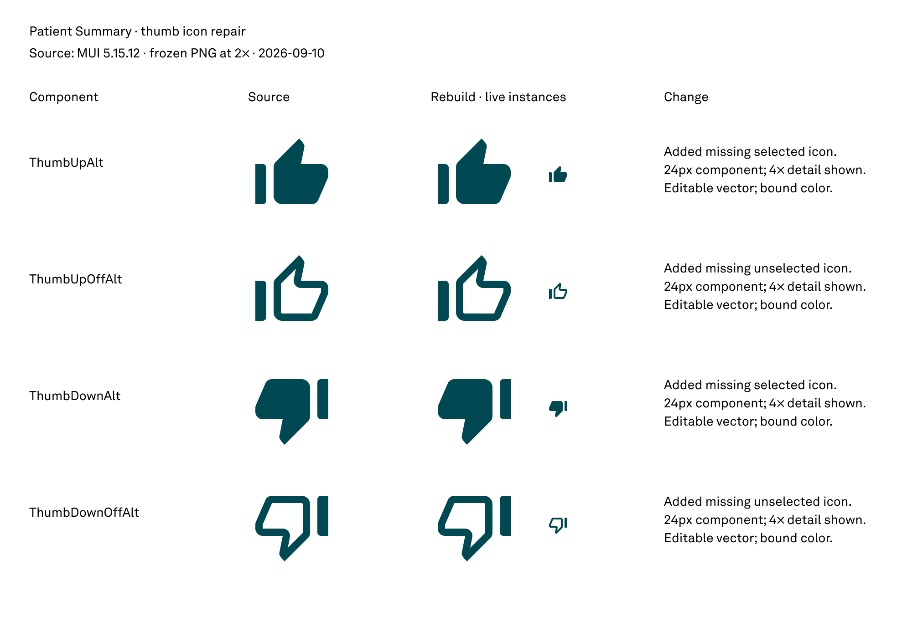

# Patient Summary thumb-icon library repair

Four missing 24px MUI Alt/OffAlt components are built and verified in the writable library. They remain unpublished pending operator review/publication. Existing icon names, keys, descriptions and vector paths are unchanged. No NPVE or source-file mutation occurred.

## Approval and scope

Operator confirmed the proposed bounded repair: **“Ok go”**. Medium risk remains marked unapproved as a general tier; the workflow records this exact per-item confirmation instead of claiming tier approval. Version-3 run and portable execution checkpoint validated before mutation; check-batch passed immediately before the one mutation call.

The NPVE-only evidence validator required an explicit library identity branch. The new identity validator still pins both writable targets to their exact page inventories and rejects source/deprecated/unknown files. Regression tests cover both targets, crossed identities and missing pages. No generic arbitrary-file bypass was added.

## Source and mapping

Code authority: design-system package requires MUI icons ^5.15.11; yarn.lock resolves 5.15.12. Patient Summary's clinical-system package resolves 5.11.16. Exact package sources for both versions are saved under source/. The library uses the design-system version's original path strings. These versions contain SVG path syntax differences (including closing commands); no path was manually redrawn or normalized.

Source images were independently rasterized with Sharp from the original SVGs to 192px PNGs, shown at 96px (2× reference density). Rebuilt icons remain editable vectors; raster images exist only in reference proofs.

| Component | Master | Key | Live instances: 24px / 96px |
|---|---|---|---|
| Icon/ThumbUpAlt (MUI) | 1080:11 | dc48038cc1e602a271ce4e5ba07d720099cabd80 | 1080:16 / 1080:14 |
| Icon/ThumbUpOffAlt (MUI) | 1080:21 | c6ddb0d4737fb41e6ba417ac97802eda28cbac85 | 1080:26 / 1080:24 |
| Icon/ThumbDownAlt (MUI) | 1080:31 | 78d7b7482ce3e0fa514ac566351699a5f92df7dd | 1080:36 / 1080:34 |
| Icon/ThumbDownOffAlt (MUI) | 1080:41 | 64189258b7ae5287ed30bee01269187c0f1e6a45 | 1080:46 / 1080:44 |

Comparison frame: **1080:2**, Reference page 259:2879. Full created-node inventory: new-node-audit.json. The library uses its existing Reference page; NPVE Screens/comparison components are not imported into the library.

## Verification

- Selected and unselected silhouettes match independently rasterized MUI source PNGs; counters remain open.
- Four 24px instances and four enlarged 96px instances show intact vector shapes and consistent teal color.
- Labels and change notes are legible, unclipped, and aligned; white backdrop and text are bound.

All ten standing checks: 

- **1_instancePaintVerification**: PASS — both 24px and 96px instances of each master match bound primary/main #004852, alpha 1; NONZERO paths verified.
- **2_unboundPaintAudit**: PASS — every top-level subtree on all 11 pages audited before/after. Existing counts 606 unchanged; every new solid paint bound. Existing paints are triage candidates, not newly declared defects.
- **3_referenceCounts**: PASS — four standalone icons have no component properties or property references; no variant combining.
- **4_skipInvisibleFalse**: PASS — false for all audit walks, including boolean-hidden descendants.
- **5_opacityLast**: PASS — no opacity override or computed-alpha workaround used.
- **6_enumerateDontRecall**: PASS — page inventory and full subtree counts enumerated live; scoped new-node inventory saved.
- **7_fileIdentityFirst**: PASS — explicit library file key and matching 11-page inventory verified; no source or NPVE writes.
- **8_roundWithRecord**: PASS — all new authored geometry integer; 24px source viewBox, 96px enlarged instance. Intrinsic vector geometry preserved without rounding.
- **9_boundPaintAlpha**: PASS — retained binding-returned opacity; primary/main is opaque. No post-binding opacity assignment.
- **10_cloneDropsPropertyRefs**: PASS — no variant clones; new instances resolve to exact masters and zero property references are expected.

Baseline unbound visible solid paints: Reference 90; Actions 6; Icons & illustrations 74; Compositions 436; all other pages zero. Final counts are identical. These existing counts include reference/composition content and need classification before repairs; count alone is not proof of a defect.

## Follow-up findings

- Existing NPVE thumb-mapping GAP remains open until publication and consumer verification. Four required assets are now available in the library draft.
- New adjacent-family GAP: ThumbUpAltOutlined and ThumbDownAltOutlined remain absent. Recorded as libraryThumbAltOutlined_followup_2026_09_10; separate batch required.
- Existing thumb descriptions claim the Alt family has no separate cuff. The four added glyphs visibly retain a cuff; treat that historical description as unreliable when selecting a specific export. Existing descriptions were preserved in this additive batch.
- No new visual DEFECTs observed. Two tracked GAP items remain open (publication dependency and adjacent exports).

## Observed usage

Provider OpenAI; model gpt-6-astra; reasoning medium. Measurement prefix 2026-09-11T00:41:33.231Z through 2026-09-11T00:53:07.409Z: 694.2 seconds, 1 user turn, 33 model responses, 32 top-level tool calls. Nested invocation counts are in measurements.json. Figma: 7 reads (including export), 1 write, 1 screenshot, 0 design correction cycles, 1 truncated-read recovery.

Tokens: input 2,867,573 (cached 2,755,968; uncached 111,605); output 17,749 including reasoning 2,260; total 2,885,322. These are repeated request totals, not unique context size. Measurements exclude later closeout and final reply. Startup context measurement is saved in context-measurement.json.

The continuation baseline remains the operator's **275-credit reading**. End reading, counter direction, credit delta and dollar cost are unavailable; no token-to-credit rate is assumed. workflow/metrics.json records observed evidence only.

## Next action

Review this comparison, then publish the four additions from the Design System Rebuild library. CLAUDE.md Publishing states that plugin API publishing and accepting updates are manual. Verify published keys from NPVE before continuing its feedback batch. Psychotherapy Note, Flowsheets and unrelated library defects remain deferred.
