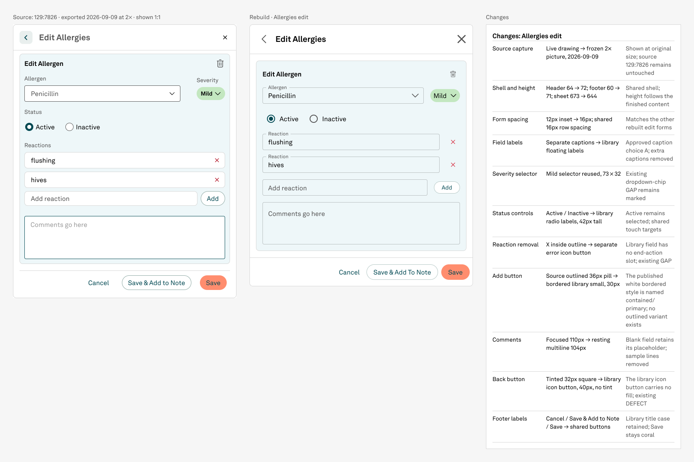

# Allergies edit — completed

The full Edit Allergies sheet is rebuilt and checked. The original and rebuild are together in Screens, section **22 · Allergies · Edit Allergen comparison**. Operator visual review remains; Family History has not started.

[Open the comparison in Figma](https://www.figma.com/design/fdCQVFdvOByaOYIJYag0d6/NPVE-Rebuild?node-id=634-12490)

## What changed

- Reused the existing Allergen instance and form rows. Corrected the heading, revealed Mild beside Penicillin, removed clipping and helper placeholders, applied the small Add button, and made Comments an empty multiline field.
- Converted the partial frame into reusable form component `634:6808` (518×468), created body `634:6809`, and placed the full 550×644 sheet `634:11956`.
- Created the frozen reference, eleven-row change log, and sole comparison `634:12490`. The two existing GAPs (severity dropdown and reaction end action) and the back-control DEFECT are marked beside it.
- Preserved the approved floating-label choice, 16px spacing, library controls, resting Comments, and coral Save. Source and library were read only.

## Why it took so long

The earlier execution had real implementation errors, rather than simply slow reasoning. The Allergen field occupied the entire row and clipped Severity. Helper text was still enabled. Several property-edit attempts did not affect the rendered controls. The pasted logs show whole-file searches, suppressed exceptions, and attempts to change properties through generic helpers; the resulting screenshot confirms the edits did not all land. One field was created without being appended to the intended form, leaving it on Cover.

The plan also requested `Button variant=outlined size=small` at 36px. The actual published Button only offers `contained` and `text`; the white bordered appearance is `contained/primary`, and its small height is 30px. This is supported by `ButtonOverrides.ts` (`containedPrimary` white fill + border), `foundation/components.json` geometry, and published variant `78:2`, key `8fc8f57f80196e40aff7b3b1116226ea0a925120`. The rebuild uses that published small button at 64×30. The original planning text is retained as history; this is a factual mapping correction under code-first authority, not a newly invented control.

Earlier transport errors may have contributed, but their network cause was not established. No transport failure recurred during this takeover. Most successful Figma calls completed in roughly 1–7 seconds. One read here used an unsupported getter on an instance; it was corrected immediately and made no mutation. This is not a controlled model benchmark, and it does not prove that switching models alone solves the workflow.

## Verification

- All four pages walked with hidden instance children included: Cover 8 nodes, Templates 10,076, Screens 4,862, Archive 1,786. Zero fractional authored geometry. Newly unbound solid paints occur only on the two organizer sections; all pre-existing exceptions are listed in `live-audit.json`.
- Form, body, Severity, and all three comparison helpers were compared to actual placed instances: 191 solid paints in total, zero differences in color, opacity or bindings. Reference helper contributes no solid paints.
- Exactly one placement of each new helper, form and body inside the comparison. Shared shell defaults and all three 550×600 variants remain unchanged; body choices grew 15→16 and comparison choices 18→19.
- Original 1100×1346 PNG uploaded unchanged and displayed at 550×673. Complete comparison, standalone sheet and markers inspected visually. No default Button/Edit Event/helper/sample-comment text remains visible.
- Probe `614:11466` was already absent when checked; no PROBE nodes remain anywhere. The former frame `614:11471` became component `634:6808`; all existing child IDs were preserved. No node was deleted during this takeover.

## Evidence

- `comparison-allergies-edit.png` — full comparison at natural resolution.
- `comparison-with-markers.png` — organizer with two GAP markers and one DEFECT marker.
- `rebuilt-sheet.png` — finished sheet.
- `reference-2x-129-7826.png` — inherited frozen source.
- `current-form-614-11471.png` — inherited unfinished form, retained as before evidence.
- `corrected-form.png` — intermediate correction pass, retained as history; final sheet supersedes it.
- `live-audit.json` and `audit-allergies-edit.json` — actual readback and validation evidence.

The pre-existing `.clinerules` setup file is preserved unchanged separately from the design batch. The old MCP session note is historical: authenticated remote Figma writes worked in this session.
