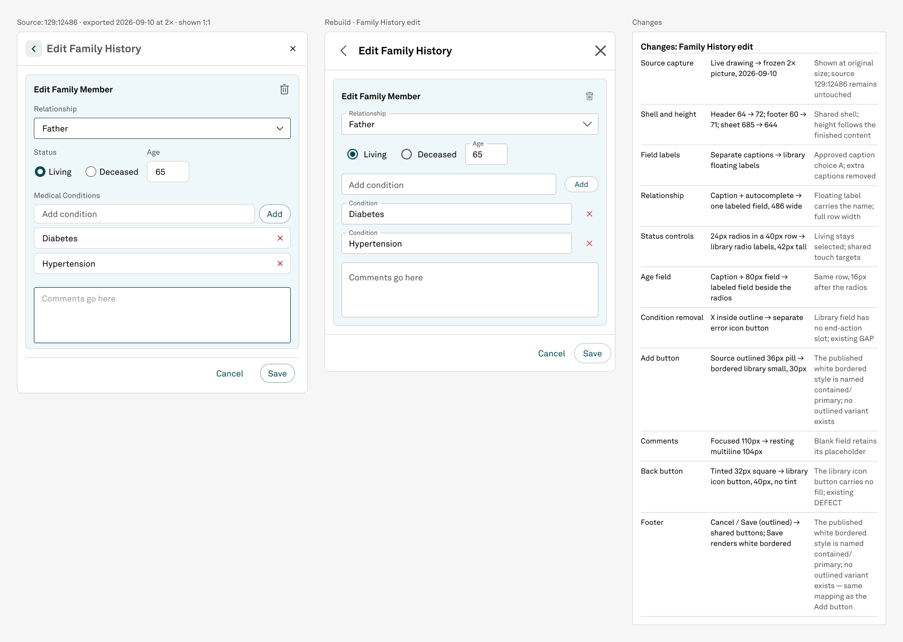

# Family History edit — completed

The Edit Family History sidesheet is rebuilt, corrected, and structurally ready for reuse. The full original/rebuild/change comparison is in Screens section **23 · Family history · Edit Family Member comparison**.

[Open the comparison in Figma](https://www.figma.com/design/fdCQVFdvOByaOYIJYag0d6/NPVE-Rebuild?node-id=638-13053)

## Final corrections from the cross-model handoff

- Bound Relationship, Age, Add condition, both condition rows, and Comments to the white paper surface. The card remains pale teal, so the field hierarchy now matches the reference and the recorded appearance specification.
- Replaced eight inherited Allergies-oriented layer names with Family History semantics. This changes no pixels, but makes the component safe for later model discovery and reuse.
- Added the Family History body and its three comparison helpers to the existing shared swap menus. The Sidesheet menu is now 17 choices and each comparison slot is 20 choices; all defaults and master dimensions remain unchanged.
- Preserved the earlier caption, Comments, content, state, layout, and footer corrections.

## Whole-form review

- Surfaces: pale teal card, six white fields, and white footer are distinct.
- Borders: card, fields, sheet outline, header divider, and footer divider are visible and unclipped.
- Content and states: Father, Living selected, Deceased unselected, age 65, Add condition, Diabetes, Hypertension, and Comments all render once in order.
- Layout: 518×468 form and 550×644 content-driven sheet; no clipped labels, controls, or actions.
- Actions: back, close, trash, both remove controls, Add, Cancel, and Save are present.

The planned condition end-adornment GAP and back-control DEFECT remain marked. The source-specific outlined Save inconsistency remains recorded for operator consideration; this batch does not generalize that source behavior.

## Verification

All four pages were walked with hidden instance children included. Locally authored geometry has no fractional values. Five master/actual-instance comparisons match across 352 solid paints. The source and library were read only. The full audit is in `audit-family-history-edit.json`; resumable mappings and corrections are in `execution.json`.

The reusable appearance specification added during this handoff is `workflow/appearance/npve-edit-forms.md`. Its tracked finding remains open because Allergies and the isolated model-test derivative still require their own review; Family History is now marked verified.

## Evidence

- `comparison-family-history-edit.png` — final comparison at natural resolution.
- `form-636-3-final-white.png` — final reusable form.
- `reference-2x-129-12486.png` — frozen source export.
- `audit-family-history-edit.json` — deterministic and visual closeout evidence.
- `execution.json` — cross-model checkpoint, corrections, appearance review, and control mappings.
