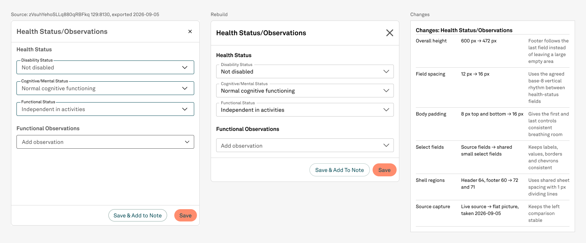

# NPVE rebuild — Health Status/Observations

Status: DONE  
Date: 2026-09-05

## Pre-write audit

The live 550 × 600 source contains three populated Health Status selects, one empty Functional Observations select, and a two-action footer. All four controls map directly to the published Text field component. No new token, icon, interaction, GAP, DEFECT, or design decision is required.

The bounded batch will keep the source labels and values, normalize the 12px field spacing to the agreed 16px base-8 rhythm, preserve the 24px separation between content sections, and remove the fixed empty body space by using the shared content-driven Sidesheet.

## Stop condition

Stop on a file or node identity mismatch, missing live dependency, unexpressible source pattern, or new design decision. Otherwise stop after the body, Sidesheet, frozen reference, conforming change log, sole comparison, screenshots, ten standing rules, and final record are complete.

## Outcome

Health Status/Observations is now a reusable Sidesheet body and one live shared-shell screen. The source is preserved as a frozen 2x image at its native 550 × 600 canvas size; the rebuilt sheet is 550 × 472 because its footer follows the final field instead of reproducing the source's unused body space.

## What changed

- Kept the source title, two section headings, four field labels, three populated values, empty observation field, and two footer actions.
- Changed the source's 12px health-field gaps to the agreed 16px base-8 rhythm.
- Preserved the source's meaningful 24px separation between Health Status and Functional Observations.
- Used 16px Sidesheet body inset and the shared 72px header / 1px divider / 71px footer shell.
- Replaced the source's fixed 476px body with a 328px content region, removing 128px of unused sheet height.

## Reuse and structure

- Body component: `412:3889` — 518 × 296.
- Four controls are live remote published Text field variants; three are filled small selects and one is an empty small select.
- Sidesheet: `413:7011` — live instance of shared Floating variant `6:65`, 550 × 472.
- Reference helper: `415:4050`; rebuild helper: `413:7010`; change-log helper: `415:7108`.
- Sole comparison: `415:7208` on Screens section `415:7207`.
- The new body and three comparison helpers were appended to preferred-value lists; shared defaults and geometry were left unchanged.

## Verification

- Visual review: PASS. Every label, value, heading, action, border, and chevron is visible and uncut.
- Spacing: PASS. 16px within sections, 24px between sections, 16px shell body inset.
- Footer behavior: PASS. Header 72, divider 1, body 328, footer 71; total 472.
- Paint audit: PASS. Templates, Screens, and Archive contain zero unbound solid paints. Cover retains its single known pre-existing exception on `1:5`.
- Whole pixels: PASS for all authored and visible batch geometry. One pre-existing fractional text position exists inside the shared shell's hidden full-width action and was not changed or exposed here.
- Placement: PASS. Each new helper has exactly one instance, inside the sole comparison.
- Source/library policy: PASS. Source was read/exported only; no library write occurred.
- Findings: 0 GAP, 0 DEFECT, 0 DECISION.

## Files

- `source-health-status-129-8130-2x.png` — frozen source export.
- `body-health-status-observations.png` — reusable body preview.
- `rebuild-health-status-observations.png` — rebuilt live Sidesheet.
- `comparison-health-status-observations.png` — final reference/rebuild/change-log comparison.

## Follow-up — 2026-09-06

Functional Observations was optically corrected from a 16px to an 8px heading-to-empty-field gap. The current body is 518 × 288 and the current sheet is 550 × 464. See `../npve-health-status-optical-spacing-2026-09-06/report.md` for the current screenshot and verification.
