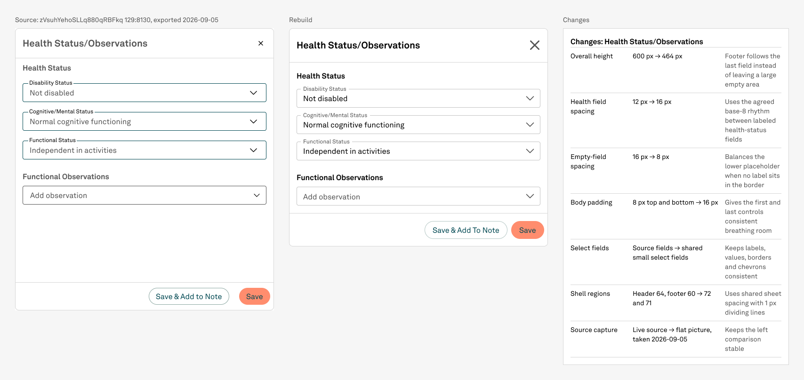

# NPVE rebuild — Health Status/Observations optical spacing

Status: DONE  
Date: 2026-09-06

## Trigger

The Functional Observations heading reads farther from its dropdown than the Health Status heading reads from its dropdowns, even though both frames use a 16px layout gap.

## Measured cause

The filled Health Status field has a floating label that renders 8px above its 40px instance box. The empty Add observation field has no floating label and keeps its placeholder inside the box. Equal geometric gaps therefore produce unequal visible spacing.

## Bounded correction

Change only the Functional Observations heading-to-field gap from 16px to the bound 8px spacing token. Reduce the dependent section, body, Sidesheet, and helper heights by 8px; keep every other spacing value and all content unchanged.

## Stop condition

Stop after the spacing and dependent heights are corrected, the existing change log is updated, screenshots are inspected, all ten standing rules pass, and the schema record is finalized.

## Outcome

The Functional Observations gap is now 8px and bound to `space/8`. Health Status keeps its 16px labeled-field rhythm, the two sections remain 24px apart, and no content or component properties changed.

## Geometry

- Functional Observations: 518 × 72, with an 8px heading-to-field gap.
- Body: 518 × 288.
- Live Sidesheet: 550 × 464.
- Shell stack: 72px header, 1px divider, 320px body region, 71px footer.
- Change log: 480 × 716 with seven visible live rows.
- Comparison: 1708 × 808.

## Verification

- Visual review: PASS. The empty field now reads evenly with the labeled field group and remains comfortably separated from its heading.
- Token binding: PASS. The corrected gap uses the published `space/8` variable.
- Content: PASS. All four published Text field instances retain their labels, values, and variants.
- Footer: PASS. It begins immediately after the content region; nothing is clipped.
- Placement: PASS. Reference, rebuild, and change helpers each remain placed exactly once inside the sole comparison.
- Paint audit: PASS. Templates, Screens, and Archive contain zero unbound solid paints; Cover keeps its one known pre-existing exception.
- Whole pixels: PASS for all authored and visible correction geometry. The shared shell still carries its previously recorded hidden full-width-action half-pixel text position; it was not changed or exposed.
- Findings: 0 GAP, 0 DEFECT, 0 DECISION.

## Screenshots

- `body-after.png`
- `rebuild-after.png`
- `comparison-after.png`
