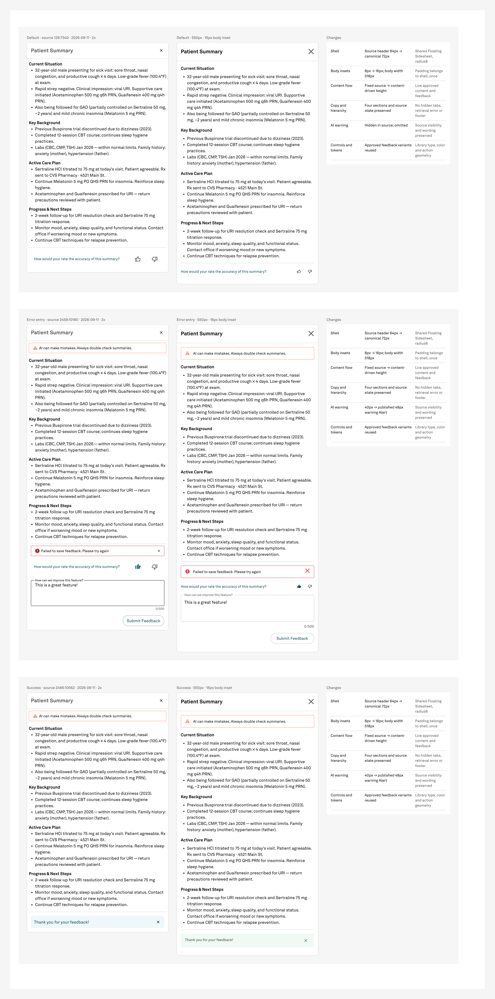

# Patient Summary — complete sheets

Completed the final Patient Summary family item: reusable body set **675:8169** and three full-sheet comparisons on Screens section **676:11185**. All three renders were inspected and shown to the operator.

| State | Body | Full sheet size | Comparison |
|---|---|---|---|
| Default | 672:7907 | 550 × 939 | 676:11186 |
| Error/Entry | 673:7962 | 550 × 1273 | 676:11724 |
| Success | 673:8308 | 550 × 1023 | 676:12320 |

## Authority and scope

Exact operator quote: “then proceed to the next step”. This follows feedback review and confirms this medium-risk item; it does not approve the tier generally. Risk locked unchanged and confirmation recorded through start-batch. Expected record opened before mutation; version3 run/version2 checkpoint validated. check-batch immediately preceded all five Plugin API mutations and three image POSTs. Source and library files received no writes.

Shared Sidesheet supplies 16px body padding. The reusable body width is518px inside550px; no horizontal padding is lost or doubled. Header72px plus1px divider, radius8, no back/footer. Independent body blocks use16px; clinical content and feedback retain approved internal spacing.

Default omits the source-hidden warning. Error/Entry and Success include the exact warning in published standard/warning Alert, icon shown, action/close/title hidden. Source40px becomes48px. Hidden tabs, retrieval error and Learn More remain excluded. All visible clinical copy, feedback copy and source hierarchy are preserved through live component instances.

Body family appended to Sidesheet preferred values17→18; three matching helpers appended to each comparison menu20→23. Every prior value/default remains unchanged. Shared Sidesheet variants stay550×600 and comparison master1708×1290. Only placed instances hug content.

Individual renders: [Default](comparison-default.png), [Error/Entry](comparison-entry.png), [Success](comparison-success.png).

## Verification

- All three full comparisons visually inspected and displayed to operator. Source reference, live rebuild and change log are visible without clipping.
- 16px shell insets confirmed on all four sides; reusable bodies remain 518px, with no extra horizontal body padding.
- Default omits the source-hidden warning. Error/Entry and Success retain warning, exact source text and state-specific feedback.
- Clinical text remains live approved content; no truncation, invented content or rasterized rebuilt UI.

- **1_instancePaintVerification**: PASS — body master/live instance paint arrays match exactly in all three states.
- **2_unboundPaintAudit**: PASS — all top-level subtrees on all four pages audited; baseline/final unbound paints unchanged at 1/48/43/20; no new unbound paints.
- **3_referenceCounts**: PASS — descendant references 2/2, 30/30, 13/13. Each body instance adds the expected root Body content swap reference. Three matching comparison helper triples.
- **4_skipInvisibleFalse**: PASS — all walks explicitly set skipInvisibleInstanceChildren=false.
- **5_opacityLast**: PASS — no post-binding opacity edits.
- **6_enumerateDontRecall**: PASS — actual pages, shell variants, body variants, helpers and comparison instances enumerated.
- **7_fileIdentityFirst**: PASS — verified source/target/library pages and exact component keys. Every call explicitly names its file. All writes target NPVE only.
- **8_roundWithRecord**: PASS — no fractional authored geometry; inherited vector geometry untouched. Heights follow content: 939/1273/1023.
- **9_boundPaintAlpha**: PASS — returned bound paints retain alpha; no forced paint opacity.
- **10_cloneDropsPropertyRefs**: PASS — bodies built independently; post-combine descendant references and root swap binding verified.

The initial audit comparator counted the expected shell swap reference and root COMPONENT/INSTANCE type difference as mismatches; a paint-only read verified exact equality and descendant counts. No canvas correction was needed. Reference slots retain the shared600px container with clipping disabled; full frozen source images are visible and contained within the taller comparisons.

No new unresolved GAP or DEFECT. Existing unrelated register findings remain open. Required reusable helpers/comparisons retained; no disposable proofs to archive. Reference PNGs are frozen2x; rebuilds remain editable.

## Observed usage

OpenAI / gpt-6-astra / reasoning **low** (session-observed; initial medium metadata corrected). Prefix 2026-09-11T14:49:59.931Z through 2026-09-11T15:07:35.035Z: 1055.104seconds; 32 model responses; 31 top-level tool calls;21 Figma reads,8 writes,1 upload allocation,10 PNG exports,0 canvas correction cycles,1 audit interpretation correction.

Input 2982913 tokens including 2875648 cached (107265 uncached); output 24260 including 696 reasoning; total 3007173. Per-response IDs deduplicated; subsets not added twice. Excludes subsequent closeout/final response. Startup context1557986 legacy bytes/157541 lean bytes,89.9% reduction.

Latest operator credit reading143 after suspected reset. Ending reading, credit delta and dollar cost unavailable; no conversion inferred. Measurements saved in measurements.json and appended to workflow/metrics.json.

Patient Summary build family is complete. Psychotherapy Note and Flowsheets remain deferred and require separate planning.
