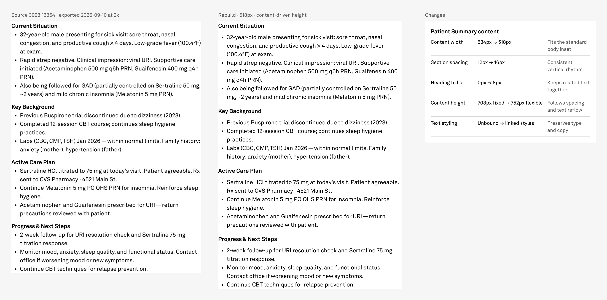

# Patient Summary content — 2026-09-10

Built one reusable **518 × 752px Patient summary content** component, preserving the source's four headings and twelve native bullet paragraphs. Dedicated reference/rebuild/change comparison inspected by Codex and shown to the operator. Item 2 remains unstarted pending operator review.

## Approval and scope

Item: `npve-patient-summary-content`, low risk. Operator approval recorded verbatim and locked with `lock-risk.js`:

> I approve the `npve-patient-summary-content`, proceed

Starting commit: `b250449`; starting tree clean. Workflow validation passed; no full aggregate or unrelated history was read. The immediately preceding Family History record was read as required by the record gate.

Source: read-only `zVsuhYehoSLLq880qRBFkq`, `3028:16364`, Summary_Wrap, 534 × 708. Target: `fdCQVFdvOByaOYIJYag0d6`, Templates `3:2`; comparison on Screens `27:2`. Source and library were never written. Figma calls were sequential; check-batch passed immediately before each mutation and the source-image upload POST.

No sidesheet, feedback controls, token creation, shared master changes, or preferred-value changes. Psychotherapy Note and Flowsheets remain deferred.

## Source → rebuild

| Treatment | Source | Rebuild | Authority |
|---|---|---|---|
| Content width | 534px | 518px | Approved manifest; canonical body inset |
| Section gap | 12px | Bound space/16 | Approved manifest and contract |
| Heading/list gap | No separate gap | Bound space/8 | Approved tight relationship |
| Heading type | Akkurat LL Bold 16/24 | Bound h4, same values | typography.ts |
| Body type | Akkurat LL Regular 16/24 | Bound body1, same values | typography.ts |
| Text color | Unbound black | color/text/primary | paletteValues.ts |
| Height | 708px source geometry | 752px, hugs content | Content-driven reflow |
| Bullets and clinical copy | Four sections, 12 bullets | Native editable text; exact equality | source.json |

The text line counts remain the same at this width; 44px added height equals four 8px heading/list gaps plus three section gaps increasing by 4px. Height is not forced to that result.

Code evidence: `C:/Code/web-app-v2/packages/design-system/src/typography/typography.ts` and `src/palette/paletteValues.ts`. Live library values and keys are in `tokens.json`; exact source strings and mixed-text hierarchy are in `source.json`.

## Figma mappings

| Object | Node |
|---|---|
| Templates section 24 | 654:9852 |
| Patient summary content | 654:9853 |
| Rebuild helper | 654:9866 |
| Content instance in helper | 654:9867 |
| Reference helper | 656:7695 |
| Frozen source rectangle | 656:7696 |
| Change-log helper | 656:7697 |
| Screens section 24 | 656:13013 |
| Sole comparison | 656:13014 |
| Reused comparison master | 35:332 |
| Reused Change log/Row master | 18:103 |

[Open comparison in Figma](https://www.figma.com/design/fdCQVFdvOByaOYIJYag0d6?node-id=656-13014)

All four helper/content master-instance identities verified. The comparison and Change log/Row definitions, preferred values, defaults and geometry are unchanged. The final comparison is 1708 × 844 with clipping disabled on its three columns. Content remains at its native 518px width inside the shared 550px slot.

## Visual evidence

- `reference-2x.png`: source exported at requested 2x. Figma returned 1069 × 1416 pixels; the unmodified image is placed at source geometry 534 × 708. The extra pixel is the exporter raster boundary, not authored geometry.
- `content-instance.png`: live instance, inspected at full text scale.
- `comparison.png`: final dedicated comparison, inspected and shown to the operator.

All headings, bullet markers and clinical wording are legible. No text, content or comparison column clips. The white surface ends after the final bullet. The change log explains every material difference. GAP **0**, DEFECT **0**, new design decisions **0**. Operator visual acceptance is pending.

## Verification

All ten standing rules passed; evidence is `audit.json`.

| Check | Result |
|---|---|
| Source-copy equality | 4/4 section strings match exactly |
| Typography | 8/8 text nodes bound for family, weight, size, line height and fill |
| Geometry | 518px width, 752px HUG height, 16px section gaps, 8px internal gaps |
| Rendered paint comparison | 40 solid paint samples across four master-instance pairs match |
| Full-file walk | 57 top-level nodes, 17,963 total nodes across all four pages |
| Unbound paint audit | 112 existing Cover/organizer paints; every new production paint bound |
| Fractional authored geometry | 0 across four pages |
| Placement | One content master and one placed comparison |
| Shared API | Definitions and geometry unchanged |
| Additive-only | No deletion, detachment, source write, or library write |

No disposable proofs were created. The actual reusable instance and sole comparison supplied the visual evidence, so proof archival is not applicable.

The execution finish-stage gate passed before record finalization. The final command transcript is saved in `closeout-checks.txt`.

## Execution and measurements

Provider **OpenAI**, model **gpt-6-astra**, reasoning **medium**, verified from session turn_context. The repository emits a **version-3 workflow run** and validates a **version-2 execution checkpoint**; this factual version distinction is documented without changing any gate.

Observed snapshot: **2026-09-10 21:19:41.880Z → 21:36:42.000Z**, **1,020.12 seconds (17.00 minutes)**, including startup and the approval wait. This is a measured prefix; subsequent closeout commands are excluded rather than guessed.

| Measurement | Observed |
|---|---:|
| Visible assistant messages | 9 |
| Logged orchestration tool calls | 37 |
| Figma reads (including discovery and exports) | 13 |
| Applied Figma writes | 4 |
| Upload URL preparations | 1 |
| Saved and inspected PNG renders | 3 |
| Visual correction cycles | 0 |
| Diagnostic recovery cycles | 3 |
| Startup legacy bytes | 1,523,655 |
| Startup lean bytes | 155,953 |
| Context reduction | 89.8% |

Tool calls count logged functions.exec wrappers; nested non-Figma operations are not independently logged. Figma writes comprise three use_figma scripts and one successful image POST. The three diagnostic recoveries were two oversized read responses replaced with compact evidence, and one explicitly hydrated Archive read that restored the README omitted by a root-only walk. No failed or replayed Figma writes.

Unavailable: exact bounded-task token totals, cost, and independent nested non-Figma tool total. No estimates supplied. `measurements.json` records the counting method and cutoff; `workflow/metrics.json` receives only this observed snapshot. Lean bytes measure the repository startup set, not all subsequent skill/tool guidance loaded.

## Record and next action

Record: `records/npve/2026-09-10/npveRebuild_patientSummaryContent_2026-09-10.json`, opened through `apply-npve-patient-summary-content.js`, finalized through `finalize-npve-patient-summary-content.js`. Approval quote, risk, node IDs, ten-rule results, appearance review and measurements are included. Contract regenerated; finish-batch and workflow validation results are in `closeout-checks.txt`.

Await operator review of item 1 before starting `npve-patient-summary-feedback`. Its medium-risk approval remains a separate boundary.
