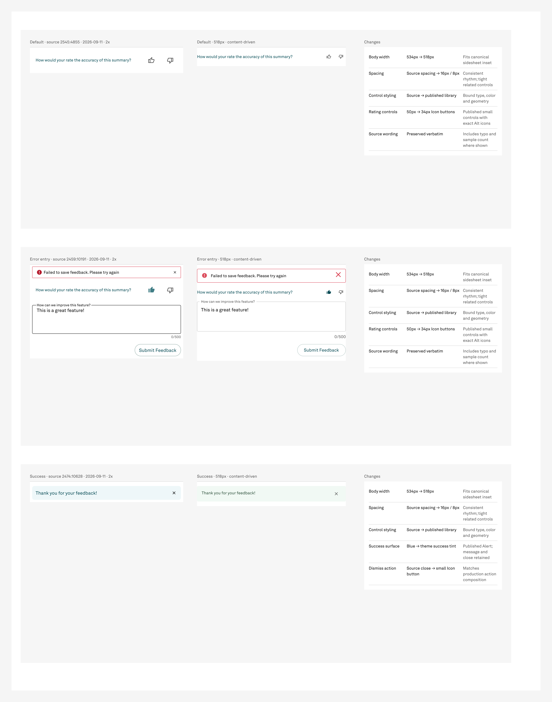

# Patient Summary feedback — completed component batch

Built one reusable three-state component set, **665:10087**, with dedicated source/rebuild/change comparisons on Screens section **668:10805**. The complete Patient Summary sidesheets have not started: operator review of these feedback states is the next gate.

## Scope and authority

Operator continuation: “Ok lets finish out the patient summary”, followed by “proceed”. The medium tier is unchanged and remains generally unapproved; start-batch records the exact per-item confirmation “proceed”. Version-3 run/version-2 execution checkpoint used. check-batch ran immediately before each canvas mutation and image POST. No source or library writes.

Four repaired library icons are published and importable; selected/unselected positive/negative mappings verified. This resolves the original thumb-mapping dependency. Full sheets and shared preferred values were untouched.

## Components and comparison

| State | Master | Size | Comparison |
|---|---|---|---|
| Default | 665:10012 | 518 × 66 | 668:10806 |
| Error/Entry | 665:10024 | 518 × 336 | 668:11210 |
| Success | 665:10076 | 518 × 86 | 668:11631 |

Rebuild helpers: 665:10088, 665:10099, 665:10150. Local production dismiss composition: 666:7826. Reference/change helpers and all created IDs are in built.json, helpers.json, comparisons.json and final-read.json.

## Visible changes and mapping

- Source width 534 → canonical 518px. Heights 90/328/72 → 66/336/86, following published controls and content. Independent spacing 16px, tight relationships 8px.
- 50px source rating controls → published 34px small Icon buttons, with exact Alt/OffAlt glyphs. Selected positive uses primary; unselected uses secondary text gray.
- Error Alert uses standard/error with close. Submit uses published contained/primary/large: the library's white bordered button, 42px tall. The native API does not offer an outlined variant; no invented variant or shared change.
- Text field uses medium/default/filled, multiline, source label/value, helper hidden; existing sample continuation text replaced with blank rows. Separate right-aligned source count remains 0/500 despite entered text.
- Success uses standard/success Alert, icon hidden to preserve message/close hierarchy. Source blue becomes the published success tint; local small default Icon button with MUI Close matches production's explicit action composition. Initial inherited red close was corrected.
- All source wording is verbatim, including “How would your rate…” and the entered sample text.

- All three states inspected in standalone live-instance PNGs and final comparison.png; no truncated wording, missing controls or clipping.
- Error/Entry preserves the filled positive thumb, unselected negative thumb, source wording and 0/500 sample count. Placeholder continuation lines cleared.
- Success uses the published green-tinted Alert with icon hidden and a default-color small Icon button/MUI Close action; source blue tint remains visible in comparison.
- All three live instance paints match masters; new authored geometry has no fractions; shared comparison definitions and geometry unchanged.

## Ten standing checks

- **1_instancePaintVerification**: PASS — three live variants match master paint arrays exactly, including bound colors and alpha.
- **2_unboundPaintAudit**: PASS — every subtree on all four pages audited; final unbound totals match baseline 1/48/43/20. Two automatic section strokes removed; no new unbound paints.
- **3_referenceCounts**: PASS — master/instance reference counts 2/2, 21/21, 6/6 after combineAsVariants; rendered text and selected icons verified.
- **4_skipInvisibleFalse**: PASS — audit walks use skipInvisibleInstanceChildren=false.
- **5_opacityLast**: PASS — no paint-opacity override used; local icon colors assigned by returned bound paint.
- **6_enumerateDontRecall**: PASS — actual page subtrees, new node IDs, variant count and instance mappings enumerated.
- **7_fileIdentityFirst**: PASS — explicit target/source/library keys; source and library reads only, all canvas writes target NPVE.
- **8_roundWithRecord**: PASS — 518px authored widths, integer geometry; intrinsic vector bounds untouched. Final heights 66/336/86 follow content and published controls.
- **9_boundPaintAlpha**: PASS — returned bound-paint alpha retained; no post-binding opacity normalization.
- **10_cloneDropsPropertyRefs**: PASS — variants built independently, not cloned; post-combine reference counts and rendered control text verified.

No new unresolved GAP or DEFECT in this feedback component. Existing unrelated register findings remain open. No disposable Figma proof nodes were created: the live helpers and comparisons are required reusable evidence, so no proof archive move is needed. Source exports are frozen 2x PNGs; rebuilt content stays editable and composed of live instances.

## Usage

OpenAI / gpt-6-astra / medium. Build prefix 2026-09-11T14:02:25.604Z through 2026-09-11T14:16:20.874Z: 835.27 seconds, 26 model responses, 26 top-level tool calls, 17 Figma reads (8 Plugin API reads + 9 exports), 8 canvas writes (5 Plugin API mutations + 3 uploads), 1 upload allocation, 9 screenshots, 2 correction cycles and 1 read recovery. Previous preflight measurements remain separately preserved.

Input 4908470 tokens, including 4850816 cached (57654 uncached); output 18111, including 4962 reasoning; total 4926581. Summed once per response ID; repeated context is included. Prefix excludes subsequent closeout and final reply. Startup context: 1551904 legacy bytes, 157319 lean bytes, 89.9% reduction.

Credit baseline **143** after suspected reset. End reading, direction, credit delta and dollar cost unavailable; no conversion inferred. See build-measurements.json and workflow/metrics.json.

## Review gate

Review all three comparisons. After operator acceptance, the remaining queued item composes content and feedback into the three full Patient Summary sheet states.
