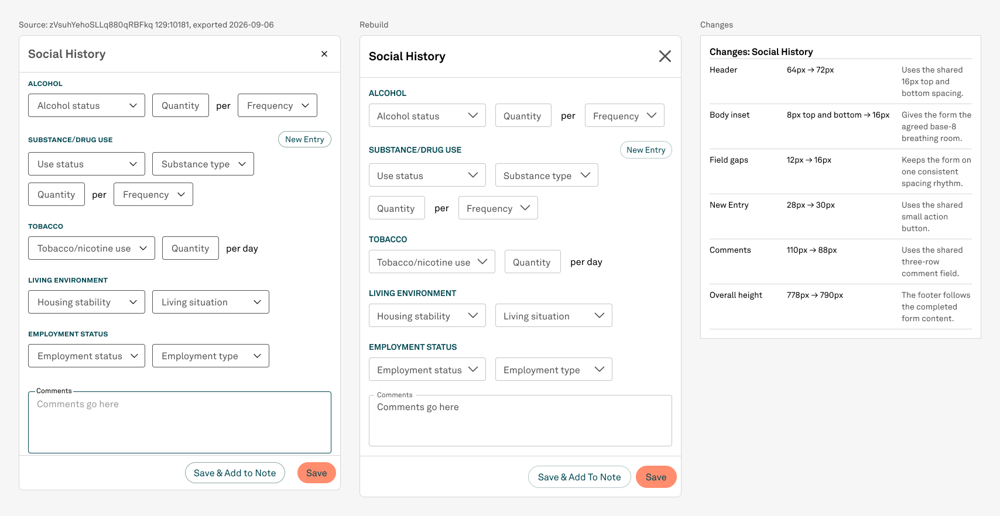

# NPVE rebuild — Social History

Status: DONE
Date: 2026-09-06

## Pre-write audit

The live 550 × 778 source contains five section groups, thirteen compact single-line fields, three inline unit-label placements, one New Entry action, one multiline Comments field, and a two-action footer. Every control maps to a published Design System Rebuild component: small Text field instances for all fields and a small contained-primary Button for New Entry. Section headings and unit labels are the only free-standing text and use bound Akkurat LL typography and colour tokens.

The target file still has the shared Sidesheet, Rebuild comparison, and Change log APIs intact. Social History will be added after the current section 15 Encounter page shell, without moving or modifying any existing section.

## Stop condition

Stop if a published Text field or Button cannot express the source in render, if file or dependency identity changes, if a hand-drawn control would be required, or if a new design decision appears. Otherwise stop after the reusable body, shared-shell sheet, frozen reference, change log, sole comparison, screenshots, standing-rule verification, and final record are complete.

## Planned spacing

- 16px Sidesheet body inset and general vertical element rhythm.
- 24px between semantic section groups.
- 8px only where a section heading's line box optically pairs with its first control row.
- Footer follows the final field; no fixed empty body height.

## Outcome

Social History is now a reusable 518 × 614 Sidesheet body and one live 550 × 790 shared-shell screen. The rebuild preserves the source form structure and copy, uses published fields and buttons throughout, and keeps the sheet at the canonical 550px width.

## What changed

- Kept the five source sections, thirteen single-line fields, multiline Comments field, unit labels, New Entry action, and two footer actions.
- Matched the source section-heading treatment with published h5 geometry: Akkurat LL Bold, 14/20, primary teal.
- Changed the source's 12px field-row gaps to the agreed 16px base-8 rhythm.
- Changed the source's 8px vertical body inset to 16px while retaining its 16px side inset.
- Used the published 30px small Button for New Entry instead of the source's 28px drawing.
- Used the published 88px three-row Text field for Comments instead of the source's 110px local drawing.
- Used the shared 72px header, 1px divider, and 71px footer; the resulting content-driven sheet is 790px tall versus the 778px source.

## Reuse and structure

- Body component: `441:4994` — 518 × 614.
- Fourteen controls are live published Text field instances; one live published Button instance provides New Entry.
- Sidesheet: `444:5270` — live instance of shared Floating variant `6:65`, 550 × 790.
- Reference helper: `446:5473`; rebuild helper: `444:5269`; change-log helper: `446:5475`.
- Sole comparison: `446:9237` on Screens section `446:9236`.
- The new body and three helpers were appended to preferred-value lists; shared defaults and master geometry were unchanged.

## Verification

- Visual review: PASS. Every heading, field, unit label, action, border, and caret is visible and uncut.
- Spacing: PASS. 8px heading/control pairing, 16px field-row gaps and body inset, 24px between semantic groups.
- Footer behavior: PASS. Header 72, divider 1, body 646, footer 71; total 790.
- Paint audit: PASS. Templates, Screens, and Archive contain zero unbound solid paints. Cover retains its single known pre-existing exception on `1:5`.
- Whole pixels: PASS. No fractional authored or visible batch geometry remains.
- Placement: PASS. Each new helper has exactly one instance inside the sole comparison.
- Source/library policy: PASS. Source was read/exported only; the library was searched/read only.
- Findings: 0 GAP, 0 DEFECT, 0 DECISION.

## Concurrent register note

The schema flag count changed from 264 to 272 while this batch was in progress. All eight additions belong to `npveRebuild_encounterShell_2026-09-06`; they were preserved and explicitly excluded from this batch's findings. Social History added no flags.

## Files

- `source-social-history-129-10181-2x.png` — frozen 1100 × 1556 source export.
- `body-social-history.png` — reusable body render.
- `rebuild-social-history.png` — rebuilt live Sidesheet.
- `comparison-social-history.png` — final reference/rebuild/change-log comparison.
