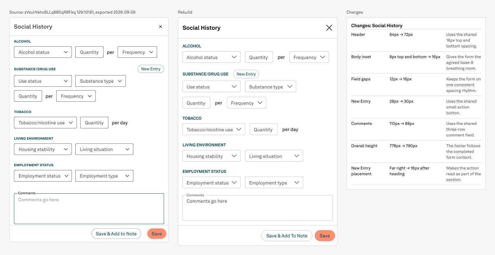

# NPVE rebuild — Social History New Entry placement

Status: DONE
Date: 2026-09-06

## Decision

Keep the frozen source reference unchanged. In the rebuild, place New Entry immediately after the SUBSTANCE/DRUG USE heading with a 16px gap so the action reads as belonging to that section.

## Stop condition

Stop if the alignment change alters sheet height, breaks component identity, clips content, creates fractional authored geometry, or exposes another design decision. Otherwise stop after the targeted placement, change-log row, fresh screenshots, standing-rule verification, and final record.

## Outcome

New Entry now sits immediately after the SUBSTANCE/DRUG USE heading with a measured 16px gap. It remains the same live published Button instance. The Social History body remains 518 × 614, the shared-shell Sidesheet remains 550 × 790, and the frozen source reference is unchanged.

## What changed

- Changed the existing 518px header row from far-edge distribution to start alignment.
- Preserved its existing 16px item spacing, placing the 159px heading at x=0 and the 89px New Entry button at x=175.
- Added one live change-log row: `Far right → 16px after heading` because the action now reads as part of the section.
- Changed no fields, tokens, component identities, preferred-value lists, shell dimensions, source captures, or unrelated nodes.

## Verification

- Visual review: PASS. The reference still shows the source's far-right button; the rebuild clearly associates New Entry with Substance/Drug Use.
- Geometry: PASS. Body 518 × 614; rebuilt Sidesheet 550 × 790; comparison 1708 × 882.
- Component identity: PASS. New Entry remains published Button `155:1193`, key `8fc8f57f80196e40aff7b3b1116226ea0a925120`.
- Change log: PASS. Seven visible live Change log/Row instances; three existing hidden spare rows remain untouched.
- Paints and fonts: PASS. No new unbound solid paints; free body text remains Akkurat LL with variable bindings.
- Whole pixels: PASS. All changed authored geometry is integral. A pre-existing 183.5px rendered label position inside the published full-width footer Button is intrinsic centering, not batch-authored geometry.
- Findings: 0 GAP, 0 DEFECT, 0 unresolved DECISION.

## Files

- `body-social-history.png` — updated reusable body.
- `rebuild-social-history.png` — updated live shared-shell Sidesheet.
- `comparison-social-history.png` — final reference/rebuild/change-log comparison.
